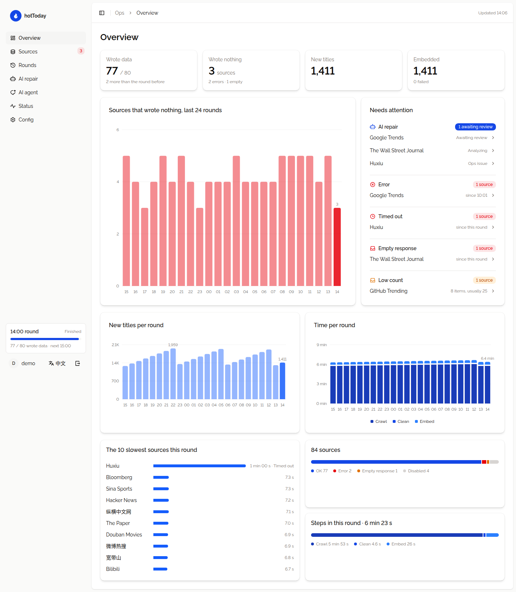
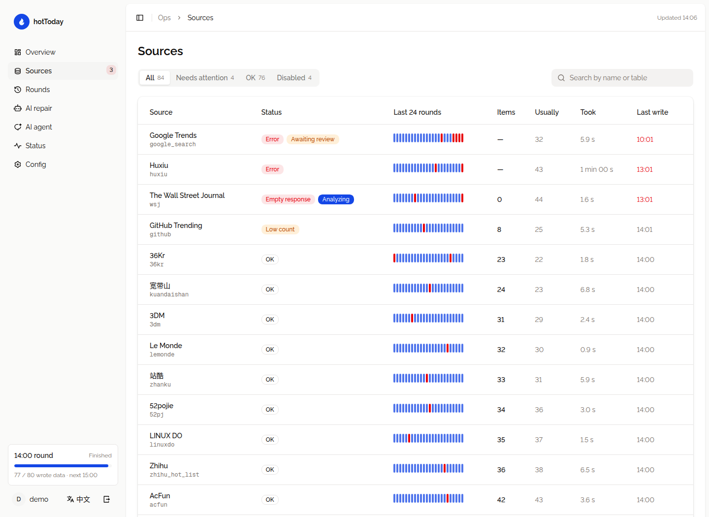
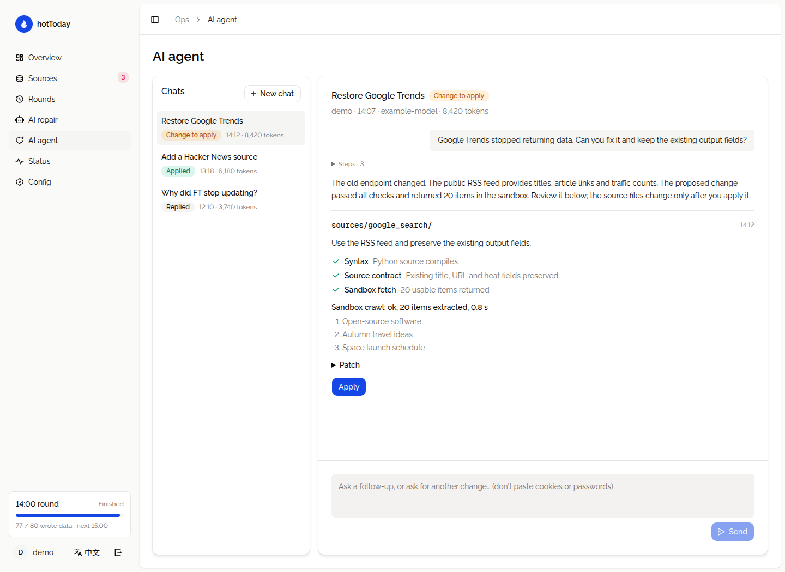

# hotToday

**English** · [简体中文](README.zh-CN.md)

An hourly crawler for trending topics, news and community discussions, with source plugins, a PostgreSQL data pipeline and an operations console. Inspect failed runs, ask an AI agent to investigate a source, and review a tested patch before applying it.

[Live rankings](https://www.hotday.uk/) · [Frontend & API](https://github.com/datehoer/hot-rank-web) · [Console setup](ops/README.md)

## What it does

- **107 source plugins** for Chinese and international news, communities, technology, finance, games and design. Each source owns its fetch and extraction rules in `sources/<key>/`.
- **Hourly collection** with per-source timeouts, retries, proxy selection and dependency checks. Raw snapshots and run results go to PostgreSQL.
- **Incremental ETL** normalizes titles, links and heat values into `hot_topic`, with resumable embedding backfills.
- **Ops console** shows source health, 24-round history, low item counts, timings, repair activity and service status. English and Chinese are built in.
- **AI repair and chat** diagnose failures, propose source changes, run sandbox checks and wait for human approval. Applying a patch runs the source immediately; applied changes can be reverted.
- **Protected access** uses an admin account, signed sessions, a one-use image verification code and login rate limits.

The public ranking website and API live in [hot-rank-web](https://github.com/datehoer/hot-rank-web). This repository contains the crawler, ETL, repair worker and ops console.

## Ops console

These are browser captures of the actual console components rendered with **fictional example data**. The account, run records, model activity and article samples are illustrative; the screenshots contain no production credentials or private endpoints.

### Overview

See which sources wrote data, which need attention, and how collection, cleaning and embedding performed over the last 24 rounds.



### Source health

Filter by status, inspect item counts against the usual volume, and follow a source's repair state alongside its run history.



### AI agent

Ask about an existing source or propose a new one. Review the investigation, checks, sandbox output and patch before choosing **Apply**.



Screenshot generation is documented in [docs/examples](docs/examples/README.md).

## Quick start

For local crawler development, use Python 3.12 and PostgreSQL 16 with pgvector for the ETL pipeline. Some source plugins also require Node.js or Chrome; the [Dockerfile](Dockerfile) installs the browser and Node dependencies used by those sources.

```bash
git clone https://github.com/datehoer/hotToday.git
cd hotToday
python3.12 -m venv .venv
. .venv/bin/activate
pip install -r requirements.txt
cp config.example.py config.py
cp .env.example .env
```

Fill in your connection settings in `.env`, then load them before running local Python commands:

```bash
set -a
. ./.env
set +a
python task.py --check
```

`config.example.py` reads the PostgreSQL, Redis and proxy settings from the environment. Its copy, `config.py`, and local `.env` files are ignored by Git. Keep real credentials in those local files.

`--check` validates every source manifest and reports missing dependencies. Configure the `subpool` proxy URL if you use sources that select it. For a source that needs extra packages, binaries or environment paths, install the dependencies listed in its `requires` block, or use the Docker image.

| Command                     | Purpose                                                            |
| --------------------------- | ------------------------------------------------------------------ |
| `python task.py --check`    | Validate source definitions and dependencies                       |
| `python task.py --only cbc` | Fetch one source without writing to the database                   |
| `python task.py --config`   | Inspect the effective source and repair configuration              |
| `python task.py`            | Run a complete collection round, ETL and configured follow-up work |

Before the first full round, initialize the ETL tables using your configured PostgreSQL connection:

```bash
PGPASSWORD="$PG_PASSWORD" psql -h "$PG_HOST" -p "$PG_PORT" -U "$PG_USER" -d "$PG_DB" -f etl/schema.sql
python task.py
```

The schema requires pgvector. Source snapshot tables and the `ops` run tables are created by the crawler. Schedule `python task.py` at the start of each hour; the Docker entrypoint also runs one round per invocation. A mounted checkout lets the next round pick up source changes; rebuild the image when its dependencies change.

## Source plugins

Each source is a directory under `sources/`. Its `key` is also the source table name used by the frontend and ETL.

| Area                    | Examples                                                                |
| ----------------------- | ----------------------------------------------------------------------- |
| Trending & communities  | Baidu, Weibo, Zhihu, Bilibili, Douyin, Google Trends, V2EX, Hacker News |
| News & finance          | The Paper, Yicai, FT, WSJ, New York Times, Bloomberg, Xueqiu            |
| Technology & security   | GitHub Trending, IT Home, CSDN, Juejin, Anquanke, The Hacker News       |
| Design & games          | Dezeen, designboom, UISDC, Zcool, TapTap, Steam, Gcores                 |
| International & general | Google News, NHK, Asahi, Yonhap, Le Monde, Mumsnet                      |

The [source manifests](sources/) are the source of truth for availability. A disabled plugin stays in the catalog with `enabled: false` and a `disabled_reason`.

Direct local coverage now includes 23 sources from five countries:

| Country     | Local publishers and communities                                       |
| ----------- | ---------------------------------------------------------------------- |
| Canada      | CBC, Global News, CTV News, National Post, Radio-Canada                |
| Germany     | SPIEGEL, ZEIT, heise, Süddeutsche Zeitung, mydealz                     |
| South Korea | Naver publisher rankings, NEWSIS, Business Watch, DC Inside, Nate Pann |
| Australia   | ABC News, SBS News, OzBargain                                          |
| New Zealand | Stuff, NZ Herald, TVNZ 1News, ChoiceCheapies, Geekzone                 |

These use the sites' own feeds and pages, preserving original-language titles and links. News, editorial headlines and popularity lists are identified separately; available view counts, votes and site temperatures retain their original units. See the [local source catalog](docs/local-sources.md) for entry points, validation and the frontend card payload needed during rollout.

A simple RSS source needs only a manifest; replace the example URL with a real feed:

```yaml
key: example_feed
name: Example Feed
enabled: true
schedule: hourly
timeout: 30s
retries: 1
proxy: none
fetch:
  type: rss
  url: https://example.com/feed.xml
extract:
  list: $
  generic_fallback: false
  fields:
    title: title
    url: url
    heat: hotScore
```

Use `fetch.type: json` for an API, or `fetch.type: python` with an entry such as `spider:get_data` for custom parsing. The manifest also controls retries, timeouts, proxy selection and optional dependencies. Extraction supports nested paths, fallbacks, URL templates and regular expressions; see the contract at the top of [plugins.py](plugins.py).

Raise an exception when a fetch or parser fails so the run record preserves the cause. New sources are discovered from their directories; the first successful write creates the source table automatically. The crawler unwraps a top-level `data` array before storing snapshots, so extraction for a stored list uses `list: $`.

Run the local-source parser and extraction checks with `python -m unittest discover -s tests -v`; they use fictional fixtures without network or database access.

## AI repair

Repeated failures or unusually low item counts can open a repair task. Network, proxy, rate-limit and dependency problems are routed to ops; supported structural failures go to the model. The default automatic analysis budget is four tasks per 24 hours.

The repair worker inspects the source, gathers evidence and tests a proposed change in a sandbox. A passing change waits for review. Approval writes it into the source directory, immediately verifies a production run, and then observes later rounds. The console also offers a chat agent for investigating disabled sources and adding new ones.

Configure the API base, model and limits in **Config → AI repair** before supplying your provider's key. Keys stay in the local `.env`: `HOT_REPAIR_KEY`, falling back to `HOT_EMBED_KEY`. Browser and external-program tools require the sandbox's OS-level network isolation; see [repair.py](repair.py) and the [console deployment notes](ops/README.md).

```bash
python repair.py list
python repair.py run google_search
python repair.py approve <task-id> --by <operator>
python repair.py revert <task-id> --by <operator>
```

Run repair commands in the crawler environment. Analysis needs permission to create the unprivileged sandbox; approve/revert should run as the checkout's file owner.

## ETL and embeddings

After a collection round, `etl/incremental.py` reads new snapshots after each checkpoint and upserts normalized records into `hot_topic`. `etl/embedding_backfill.py` processes records without vectors and resumes from unfinished rows. The current embedding URL and model are configured in that file; set them for your own provider before adding `HOT_EMBED_KEY`.

```bash
python etl/incremental.py
python etl/embedding_backfill.py --limit 8000
python etl/backfill.py --months 3
```

The last command is an optional historical backfill. Extraction comes from each source's manifest, so adding a source does not require a separate ETL mapping.

## Run the console

The console is a separate Next.js app in `ops/`, using React, shadcn/ui and Recharts. It reads PostgreSQL with a read-only role; administrative actions invoke the crawler's repair/configuration commands. It is deployed separately from the crawler image.

```bash
cd ops
pnpm install --frozen-lockfile
# Configure .env.local as described in ops/README.md.
pnpm build
pnpm start --hostname 127.0.0.1 --port 3210
```

See [ops/README.md](ops/README.md) for the admin account, image verification, database permissions, reverse proxy and service configuration.

## Repository map

```text
sources/                 Source manifests and custom parsers
task.py                  Collection rounds and run records
plugins.py               Plugin loading, fetching and extraction
repair.py                AI investigations, sandboxing and patch lifecycle
etl/                     Schema, incremental ETL and embedding backfills
ops/                     Bilingual operations console
docs/images/             Example console screenshots
docs/examples/           Isolated screenshot fixtures and capture script
config.example.py        Environment-based local configuration template
```

Issues and source contributions are welcome. For a new source, include its manifest, parser if needed, and an explanation of the expected output.
